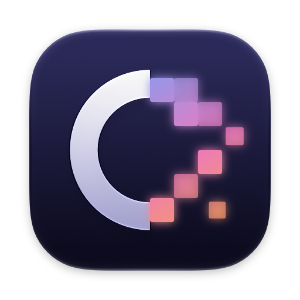
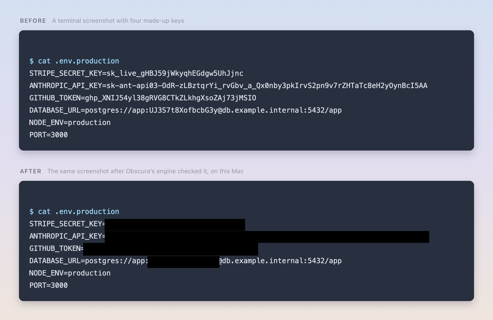
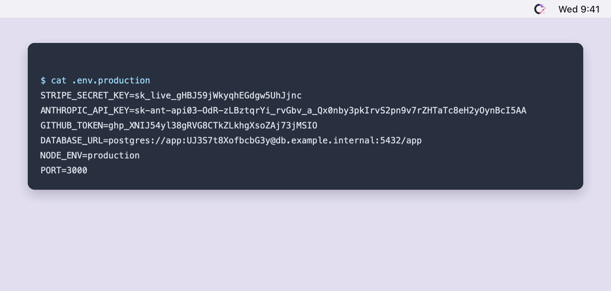
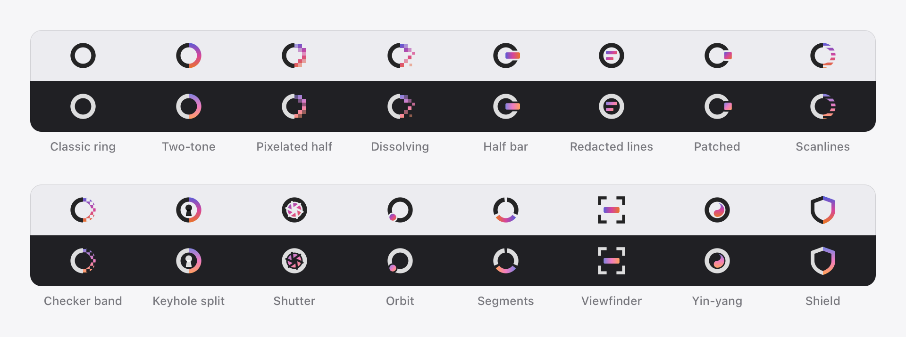
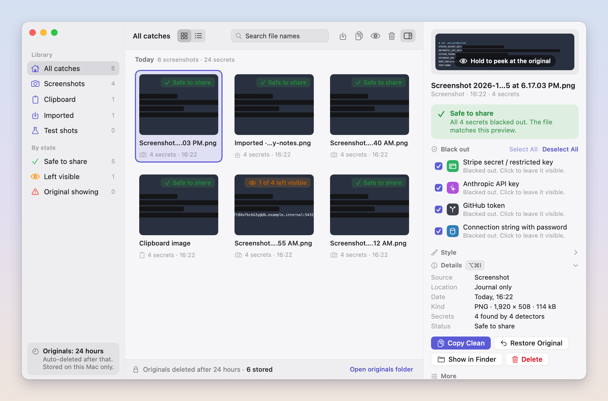
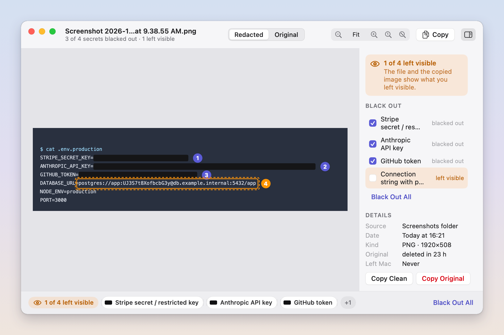
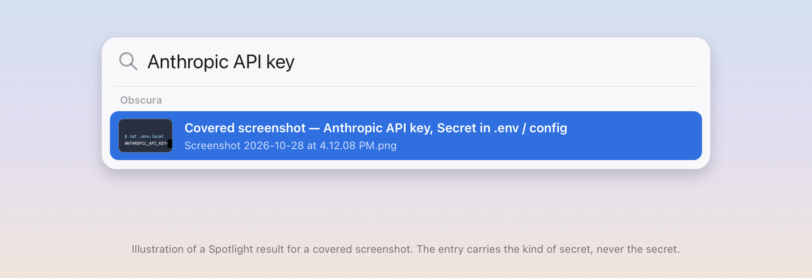
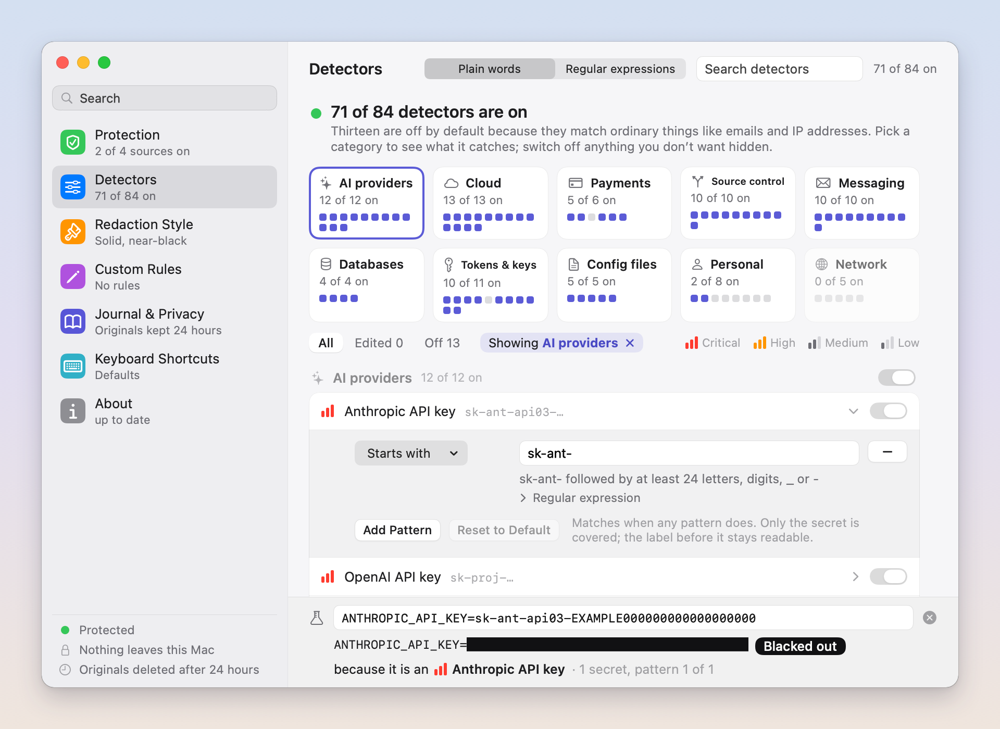

<p align="center">
  
</p>

<h1 align="center">Obscura</h1>

<p align="center">
  <b>Covers the secrets in your screenshots before you share them.</b><br>
  A free, open-source macOS menu bar app. Everything happens on your Mac.
</p>

<p align="center">
  <a href="../../releases/latest">Download</a> ·
  <a href="#install">Install</a> ·
  <a href="#security">Security</a> ·
  <a href="#build-from-source">Build from source</a> ·
  <a href="#faq">FAQ</a>
</p>

<p align="center">
  
</p>

You take a screenshot of a terminal, a config file or a dashboard and paste it into a chat. Somewhere in it is an API
key. Obscura reads every new screenshot the moment it lands, finds the keys, tokens and passwords in it, and replaces
the file with a copy where each one is behind a black bar. Press ⇧⌘4, then ⌘V, and what you paste is already covered.

The original stays private on your Mac for 24 hours (you choose how long), so one click undoes a cover you did not
want. All of it runs on-device with Apple's Vision text recognition; nothing is uploaded, ever.

*Every key in these pictures is made up.*

## What it does

<p align="center">
  
</p>

- **Screenshots.** Watches your screenshot folder (wherever ⇧⌘5 ▸ Options saves them) and covers each new picture in
  place. With "Copy screenshots to the clipboard" on (the default), ⇧⌘4 then ⌘V pastes the covered copy.
- **The clipboard.** Copy an image, or an image file in Finder, and Obscura puts a covered copy back on the
  clipboard. Plain text copied along with the image goes back too, unless it holds a secret itself; then it is left
  out and Obscura says so.
- **Downloads and folders you choose.** Turn on Downloads or add any folder; images saved there are checked the same
  way. A folder is watched only after you confirm it inside Obscura.
- **Keys written in plain words.** Not only vendor formats like `sk_live_…` or `ghp_…`: a value someone labels in
  ordinary writing (`API key: …`, `password = …`) is covered too, while the label stays readable.
- **Hard-to-read lines.** Long or small lines are read a second time, zoomed in, and common misreads are recovered.
  When a second read still comes back shorter than the line on screen, the cover runs to the end of the line rather
  than stopping where the reading stopped.
- **Never "clean" by guess.** A picture is called clean only when every line in it was really read. Anything Obscura
  could not read in full (a timeout, a busy Mac, a file it could not open) ends as **Not checked**, with a notice, a list you can
  revisit and a Check Again button. It is never marked safe.

## Why you can trust it

- **On-device.** Text recognition is Apple Vision, running locally. Obscura has no server, no account, no analytics
  and no telemetry. Its only network traffic is the update check.
- **Open source.** Every line is here under the GPL, so anyone can read what it does and build it themselves.
- **Originals stay put.** The originals Obscura keeps for undo live in a folder only your macOS user can open, kept
  out of Time Machine backups and Spotlight, and deleted after the time you chose.
- **Your rules are sealed.** Custom rules and detector edits are encrypted at rest with a key that lives in your
  Keychain, so a backup or another app reading the database sees no rule text.
- **Reviewed.** Before release the code went through a full security review and a separate review of every place a
  failure could leave a secret visible; every finding was fixed. Details are under [Security](#security).
- **Fails safe.** When in doubt it says "not checked", never "clean".

## Features

### A menu bar mark you pick

<p align="center">
  
</p>

Sixteen marks, each in four colour styles (Warm, Glass, Indigo, or one colour that follows the menu bar). Each one
shows its state in the shape first and the colour second: protected, checking, caught, paused, needs you, update
ready, and Focus holding notifications. Short animations mark what just happened (a catch snaps shut, a clipboard
catch wipes, Undo lifts the cover); with Reduce Motion on, every change is instant. You choose the mark during setup
and can change it any time in Settings.

### The Journal

<picture>
  <source media="(prefers-color-scheme: dark)" srcset="docs/media/journal-dark.png">
  
</picture>

Every catch is listed with what was found in it and whether the file is safe to share. Each finding can be uncovered
or covered again on its own, the whole picture restored, or its original peeked at while you hold the preview. Grid or list,
filters by source and state, file-name search.

### The Viewer

<picture>
  <source media="(prefers-color-scheme: dark)" srcset="docs/media/viewer-dark.png">
  
</picture>

Open any catch to see it full size, with a numbered badge on each cover. A finding you chose to leave visible keeps a
dashed outline so it is never forgotten. Compare the covered picture with its original side by side or with a wipe,
zoom, and copy the clean picture.

If you turn it on, an uncovered key can also be copied as text: it is read again from the original when you ask,
put on the clipboard marked as concealed (so clipboard managers skip it) and never stored.

### Find covered screenshots in Spotlight

<p align="center">
  
</p>

Type the kind of secret, such as "Anthropic API key" or just "API key", and Spotlight lists the covered screenshots
that held one. The entry carries the kind of secret and the file name, with a thumbnail of the covered picture: never
the secret, a part of it, or anything derived from it. Entries follow the covered file and disappear when it is
deleted. Finder tags with the same labels are available too, off by default, because tags travel with a file you
share.

### Settings

<picture>
  <source media="(prefers-color-scheme: dark)" srcset="docs/media/settings-dark.png">
  
</picture>

- **Detectors.** Every detector can be switched off, and its patterns edited in plain words ("starts with sk-ant-,
  then at least 24 letters…") or as regular expressions. Paste a line into the test field to see exactly what would
  be covered and why. Nothing typed there is saved.
- **Custom rules.** Black out your own things (customer ids, project names) or mark text that should never be
  covered.
- **How covers look.** Solid bar, erase to the background, blur or mosaic, with an optional label naming the kind of
  secret.
- **The rest.** File handling (replace the file or keep both), how long originals are kept (1 hour to 30 days), a
  corner card after each screenshot with Undo, a sound on each catch, keyboard shortcuts for every command, and
  pausing for 15 minutes, an hour, until tomorrow or until you resume.

## Built-in detectors

84 detectors, written from each vendor's public token format and checked against made-up samples of every one.
71 are on by default; the 13 that match ordinary things (email addresses, phone numbers, IP addresses and the like)
are off until you want them.

| Category | Detectors | Examples |
|---|---:|---|
| AI providers | 12 | Anthropic, OpenAI, Google Gemini, Mistral, Groq, Hugging Face, OpenRouter, xAI |
| Cloud | 13 | AWS access keys and session tokens, Azure, Google Cloud service accounts, Cloudflare, DigitalOcean, Supabase, Vercel |
| Payments | 6 | Stripe secret, restricted and webhook keys, PayPal, Shopify, Square |
| Source control & packages | 10 | GitHub, GitLab, npm, PyPI, RubyGems, Docker Hub, Atlassian, Linear, Notion |
| Messaging & email | 10 | Slack, Discord, Telegram, Twilio, SendGrid, Mailgun, Mailchimp, Postmark |
| Databases | 4 | Connection strings with a password, MongoDB Atlas, PlanetScale, JDBC / ADO.NET passwords |
| Tokens & private keys | 11 | Private key blocks (PEM, OpenSSH, PGP), JSON Web Tokens, bearer headers, Kubernetes, Sentry DSNs, 2FA setup links |
| Config files | 5 | Secrets in `.env` and YAML/JSON files, labelled passwords and secrets, secrets passed as command-line flags |
| Personal info | 8 | Payment card numbers, IBANs, US Social Security numbers, passport lines (2 on by default) |
| Network | 5 | IPv4/IPv6 and MAC addresses, internal host names, Mac serial numbers (all off by default) |

Run `swift run obscura detectors list` for the full list with each detector's id and severity.

## Requirements

- macOS 15 Sequoia or later
- Apple silicon or Intel (one universal app)

## Install

1. Download `Obscura-<version>_<build>.dmg` from the [latest release](../../releases/latest).
2. Open it and drag Obscura to your Applications folder.
3. Open Obscura. macOS says it cannot verify the developer: click **Done** (not Move to Trash).
4. Open **System Settings → Privacy & Security**, scroll to the message about Obscura, click **Open Anyway** and
   confirm with your password or Touch ID. macOS remembers this; updates do not ask again.
5. Setup walks you through the screenshot folder, notifications, opening at login and your menu bar mark.

**Why the warning?** Obscura is signed with its own certificate rather than an Apple Developer ID, because it is a
free project without a paid Apple developer account. The signature still guarantees that every release and update
comes from the same signer (Obscura checks that itself before installing an update); macOS simply has no Apple record
of who that signer is. If you would rather not take that on trust, build it yourself from this repository (below).

Keep the app in one place: macOS ties folder access to the app's signature and location, and the update check will
not run from the disk image or from a temporary copy.

## Updates

Obscura checks for a new version at most once a day (Settings → About → "Check for updates automatically"), or when
you choose **Check for Updates…**. It fetches one small signed file and nothing else; when you press **Install** it
downloads the disk image. No identifiers are sent.

Before anything is replaced:

- the update file must carry a valid **Ed25519 signature** from Obscura's update key, whose public half is built into
  the app (HTTPS only; a redirect to another host is refused);
- the version must be newer than yours (no downgrades) and support your macOS;
- the downloaded disk image must match the **size and SHA-256** the signed file names;
- the app inside must pass macOS's **code-signature check against the signer of the copy you run**, use the hardened
  runtime, and be the announced version;
- only then is the app swapped in one step, with the previous copy kept until the new one has started and put back if
  macOS will not open it.

If any check fails, your installed Obscura is left exactly as it was and the menu says why. There is no third-party
update framework in the app. A copy you built yourself (ad-hoc signed) cannot verify updates; download new versions
by hand.

**On 0.1.0 or 0.1.1?** Their installer cannot open the downloaded disk image on macOS 27, so **Install** stops with
nothing changed. Install 0.1.2 or later by hand once from the
[Releases page](https://github.com/XBTDMT/obscura/releases); from then on updates install themselves.

## Security

What Obscura does to keep your secrets, each point something you can check in the code:

- **100% on-device.** OCR is Apple Vision on your Mac. No telemetry, no analytics, no crash reporting, no accounts.
  The only network requests are the update check and, when you press Install, the update download.
- **Signed, verified updates.** An Ed25519-signed feed, a SHA-256 check of the download, and a same-signer code check
  before an atomic swap with rollback, all in Obscura's own code (see [Updates](#updates)).
- **Hardened runtime with library validation on, and zero entitlements.** Nothing but Obscura's own code and Apple's
  can load into the app.
- **Originals are private.** Kept in a folder readable only by your macOS user, excluded from Time Machine and from
  Spotlight, and deleted after your chosen time (24 hours by default). The rest of the Journal holds rectangles,
  detector names and dates, never recognised text.
- **Encrypted rules.** Custom rules and detector edits are encrypted at rest with a per-install key kept in your
  Keychain.
- **Logs never contain secret text.** Only counts, detector ids and rectangles.
- **Folders need your say-so.** Downloads and added folders are watched only after you confirm them inside Obscura;
  a preference written by another program is not enough.
- **Spotlight sees labels only.** Entries carry the kind of secret, never the secret or anything derived from it.
- **Reviewed before release.** A full, high-effort automated security review (Claude Security) produced 26 verified
  findings (9 medium, 17 low), and a separate fail-open review of every path where an error could leave a secret
  visible produced 23 more. All of them are fixed.
- **Open source** under GPL-3.0-or-later, so anyone can audit it and build it.

What it does **not** protect against:

- **The instant before the cover lands.** A screenshot exists on disk, uncovered, for the moment it takes to read it.
  A paste made in that instant, or another app that grabs new screenshots as soon as they appear (an uploader or a
  folder that syncs to the cloud), can get the original.
- **What it cannot read.** Obscura finds secrets by reading text. A secret that is not legible as text (heavily
  blurred, handwritten, at a steep angle in a photo) or that matches no detector or rule is not covered. Look before
  you share anything sensitive.
- **Anything already running as you.** Malware or another program running under your macOS account can read your
  screen, your files and the originals Obscura keeps for undo. Obscura is a safety net for sharing, not a defence
  against a compromised Mac.
- **Other kinds of sharing.** Live screen sharing, screen recordings and video are not checked.

Found a security problem? Please open a private security advisory on this repository rather than a public issue.

## Privacy

Obscura collects nothing. Your screenshots, their text and the secrets in them never leave your Mac. The originals
it keeps for undo are deleted on schedule, and you can delete them all at once in Settings → Journal & Privacy. The
update check is a plain HTTPS request for a signed file and carries no identifier.

## Build from source

You need Xcode 27 or later (Swift 6), and [XcodeGen](https://github.com/yonaskolb/XcodeGen) for the app project.

```sh
git clone https://github.com/XBTDMT/obscura.git
cd obscura

# The engine, the CLI and every test: no certificate needed.
swift build
swift test

# The app.
brew install xcodegen
xcodegen generate
open Obscura.xcodeproj        # build the Obscura scheme
```

A build from a clone is **ad-hoc signed** by default (`Apps/Obscura/Signing.xcconfig`), so it needs no certificate.
Two things differ from a release: macOS asks for folder access again after each rebuild (an ad-hoc signature changes
every time), and it cannot verify updates because there is no stable signer to compare against (download new versions by hand).

The `obscura` command-line tool runs the same engine without the app:

```sh
swift run obscura scan screenshot.png          # what would be covered (counts, detector ids and rectangles only)
swift run obscura redact screenshot.png --out covered.png
swift run obscura detectors list
swift run obscura fixtures verify              # every detector against its made-up samples
```

`Scripts/ci.sh` runs the full local check: build, tests, a scan proving the test data holds no real credentials, and
the app build.

## Releasing (maintainer)

On the release Mac only (it holds the release certificate and the update key):

1. Once: `obscura release keygen --key-item "Obscura update key" --backup-to /Volumes/<encrypted backup>/obscura-update-key.b64`
   (try `--dry-run` first), then put the printed public key and the feed address into the git-ignored
   `Apps/Obscura/Signing.local.xcconfig`: `OBSCURA_UPDATE_PUBLIC_KEY = <base64>` and
   `OBSCURA_UPDATE_FEED_URL = https:/$()/xbtdmt.github.io/obscura/obscura-update.json`.
2. `xcodegen generate`, build Release, then
   `OBSCURA_UPDATE_PUBLIC_KEY=<base64> Scripts/check-app-signature.sh <Obscura.app> --release`. It refuses an app
   that does not hold that public key, a placeholder feed address, any entitlement, an earlier identity
   (`OBSCURA_PREVIOUS_IDENTITY` must be empty) and a bundle that still names the build Mac's folders.
3. `Scripts/make-dmg.sh <Obscura.app> dist`, then
   `OBSCURA_UPDATE_KEY_ITEM="Obscura update key" Scripts/make-feed.sh <Obscura.app> dist/<dmg> https://xbtdmt.github.io/obscura/releases/<dmg>`.
4. Publish the DMG and `dist/obscura-update.json` on GitHub Pages at those addresses (the DMG must be served without a
   redirect to another host), and attach the same DMG to the GitHub Release for manual downloads.

## Uninstall

1. In Settings → Journal & Privacy, turn off "Find covered screenshots in Spotlight" (this removes Obscura's
   Spotlight entries), then choose **Quit Obscura** from its menu.
2. Move Obscura from Applications to the Trash.
3. To remove its data too, delete `~/Library/Application Support/Obscura` (the Journal and your rules) and
   `~/Library/Application Support/Obscura-Backups` if it exists, then run
   `defaults delete io.github.xbtdmt.obscura` for its settings.
4. Optional: in Keychain Access, delete the items whose name begins with "Obscura" (the rule key and folder
   confirmations).

Covered files stay covered after you uninstall; only the originals in the Journal are removed.

## FAQ

**Does it change my screenshot file?**
By default it replaces the file with the covered copy, so whatever picks the file up later sees only the covered
version. You can choose "keep both" in Settings instead. The original is in the Journal for undo until it expires.

**What if it covers something that is not a secret?**
Uncover just that finding in the Journal or the Viewer (or undo the whole catch from the corner card); the file
updates at once.
Add a "never black out" rule if it keeps happening, or switch that detector off.

**What if it misses something?**
Add a custom rule for it. If it is a common key format, please open an issue with a made-up example.

**Does it read my screen all the time?**
No. It looks only at new images: new files in the folders it watches and images you copy. It does not record the
screen.

**What happens when my Mac is busy?**
Checking may take longer. If a picture cannot be read in full in time, it is marked Not checked and listed so you can
check it again; it is never passed as clean.

**Will it slow my Mac down?**
It reads one picture at a time when one arrives, and is idle otherwise.

**Can I pause it?**
Yes, from the menu: 15 minutes, an hour, until tomorrow or until you resume. The menu bar mark changes colour while paused.

**Is it free?**
Yes, and it will stay free and open source.

## Contributing

Issues and pull requests are welcome. A few house rules:

- Every secret in code, tests, fixtures and pictures must be made up. `Scripts/scan-fixtures-for-real-secrets.sh`
  checks the shapes that matter.
- Logs and test output never contain recognised text: counts, detector ids and rectangles only.
- Swift 6 with strict concurrency; the engine lives in Swift packages that are tested without the UI.
- Run `Scripts/ci.sh` before opening a pull request.

## License

Obscura is free software under the **GNU General Public License, version 3 or later** (GPL-3.0-or-later): you may
use, study, share and change it, and anything you distribute that is built from it must stay open under the same
terms. The full text is in [LICENSE](LICENSE). Its one third-party package, swift-argument-parser (used by the
command-line tool), is under the Apache License 2.0, which is compatible with GPL version 3.

## Credits

Made by [XBTDMT](https://github.com/XBTDMT).
